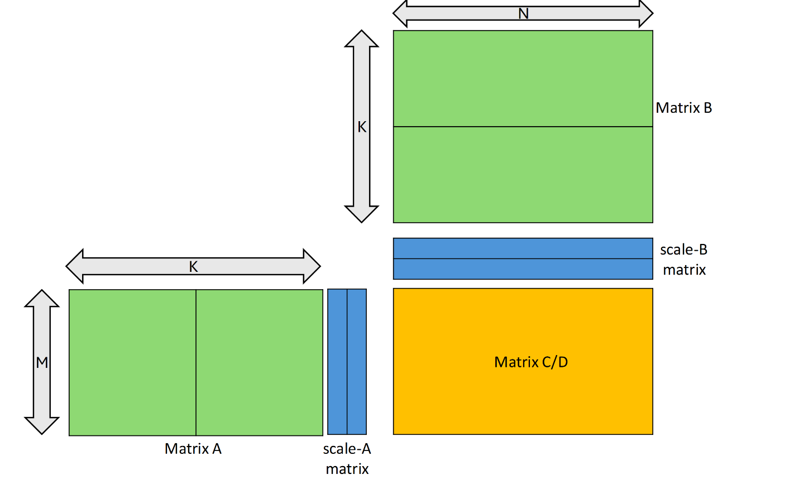
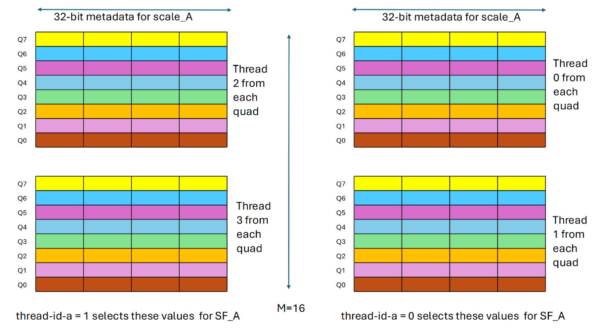
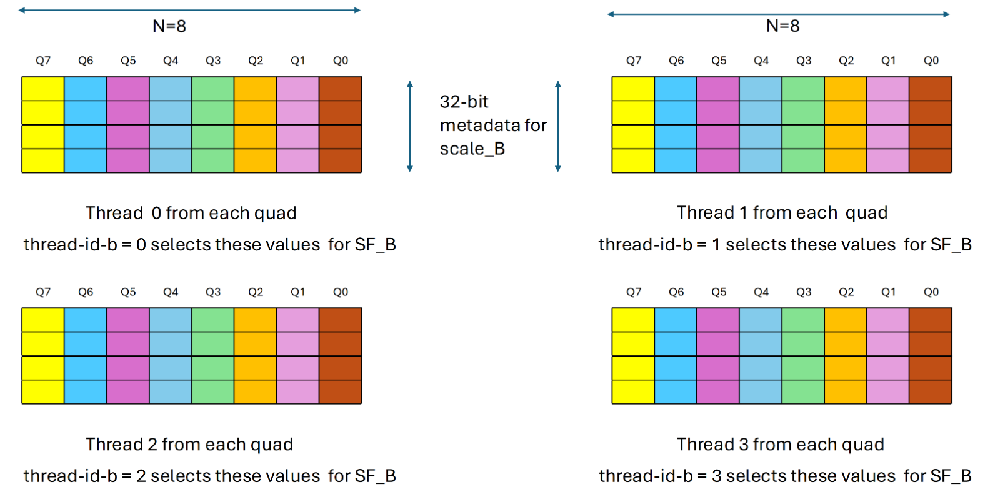
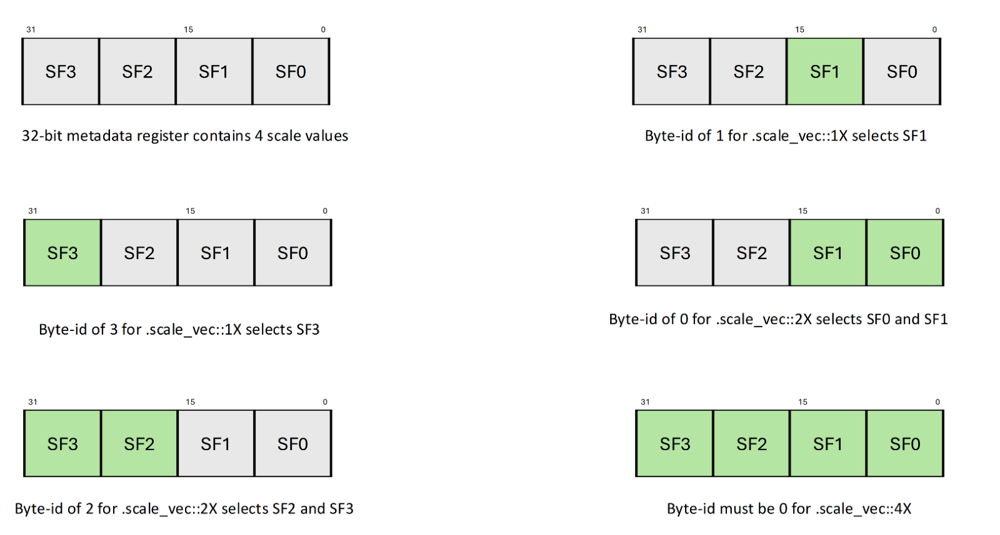

<!-- Generated from https://docs.nvidia.com/cuda/archive/12.9.1/parallel-thread-execution/index.html by tools/build_ptx.py; do not edit. -->

# 9.7.14.3. Block Scaling

The `mma` instruction with the following `.kind` qualifier:

- `.kind::mxf8f6f4`

- `.kind::mxf4`

- `.kind::mxf4nvf4`

perform matrix multiplication with block scaling. This operation has the following form: `D`` ``=`` ``(A`` ``*`` ``scale_A)`` ``*`` ``(B`` ``*`` ``scale_B)`` ``+`` ``C`.

For a `scale_A` matrix of shape *M x SFA_N*, each row of matrix `A` is divided into *SFA_N* number of chunks and each chunk of a row is multiplied with the corresponding element (henceforth referred as *SF_A*) from the same row of `scale_A`.

Similarly, for a `scale_B` matrix of shape *SFB_M x N*, each column of matrix `B` is divided into the *SFB_M* number of chunks and each chunk of a column is multiplied with the corresponding element (henceforth referred as *SF_B*) from the same column of `scale_B`.

[Figure 42](https://docs.nvidia.com/cuda/archive/12.9.1/parallel-thread-execution/index.html#mma-block-scaling) shows an example of `mma` with block scaling of `scale_vec::2X`.

Figure 42 `mma` with block scaling of `.scale_vec::2X`[](#mma-block-scaling "Permalink to this image")

The shapes for `scale_A` and `scale_B` matrices depend upon the qualifier `.scale_vec_size` as shown in [Table 36](https://docs.nvidia.com/cuda/archive/12.9.1/parallel-thread-execution/index.html#mma-scale-vec-matrix-shape).

| .scale_vec_size  | Shape of scale_A | Shape of scale_B |
|------------------|------------------|------------------|
| `.scale_vec::1X` | M x 1            | 1 x N            |
| `.scale_vec::2X` | M x 2            | 2 x N            |
| `.scale_vec::4X` | M x 4            | 4 x N            |

Table 36 Shapes for scale matrices depending upon `.scale_vec_size` qualifier[](#mma-scale-vec-matrix-shape "Permalink to this table") {#mma-scale-vec-matrix-shape}

The valid combination of the exact element types and the `.scale_vec_size` are listed in [Table 37](https://docs.nvidia.com/cuda/archive/12.9.1/parallel-thread-execution/index.html#mma-scaling-kind-type-valid-combination).

| .kind::\* | Element Data Type .atype and .btype | Scale Data Type .stype | .scale_vec_size |
|----|----|----|----|
| `.kind::mxf8f6f4` | `.e4m3`, `.e5m2` `.e3m2`, `.e2m3` `.e2m1` | `.ue8m0` | `.scale_vec::1X` |
| `.kind::mxf4` | `.e2m1` | `.ue8m0` | `.scale_vec::2X` |
| `.kind::mxf4nvf4` | `.e2m1` | `.ue8m0` | `.scale_vec::2X` |
|  | `.e2m1` | `.ue4m3` | `.scale_vec::4X` |

Table 37 Valid combinations of `.scale_vec_size` and `.kind` qualifier[](#mma-scaling-kind-type-valid-combination "Permalink to this table") {#mma-scaling-kind-type-valid-combination}

The `scale-a-data` and `scale-b-data` argument provides metadata for `scale_A` and `scale_B` matrices respectively. The tuple `{byte-id-a,`` ``thread-id-a}` and `{byte-id-b,`` ``thread-id-b}` provides the selector information to choose elements *SF_A* and *SF_B* from corresponding metadata arguments `scale-a-data` and `scale-b-data`. The tuple `{byte-id-a,`` ``thread-id-a}` allows to select the scale matrix element *SF_A* from `scale-a-data`. Similarly, the tuple `{byte-id-b,`` ``thread-id-b}` allows to select the scale matrix element *SF_B* from `scale-b-data`.

The components `thread-id-a`, `thread-id-b` decides which threads among the quad contribute the *SF_A* and *SF_B* values. The following listing describes the impact of thread selector component `thread-id-a`, `thread-id-b`:

- One thread-pair within the quad determined by `thread-id-a`, contributes the *SF_A* values. The value of 0 selects lower two threads whereas value of 1 selects upper two threads from the quad. In other words, when `thread-id-a` set to 0, thread-pair satisfying: `%laneid` % 4 == 0 or 1 provides the *SF_A*. In contrast when `thread-id-a` set to 1, thread-pair satisfying: `%laneid` % 4 == 2 or 3 provides the *SF_A*. Refer [Figure 43](https://docs.nvidia.com/cuda/archive/12.9.1/parallel-thread-execution/index.html#mma-scaling-thread-id-a-selection) for more details.

  
  Figure 43 Selection of set of values for *SF_A* based on `thread-id-a`[](#mma-scaling-thread-id-a-selection "Permalink to this image")

- One thread within the quad, determined by `thread-id-b`, contributes the *SF_B* value. In other words, each thread satisfying: `%laneid` % 4 == `thread-id-b` provides the *SF_B*. Refer [Figure 44](https://docs.nvidia.com/cuda/archive/12.9.1/parallel-thread-execution/index.html#mma-scaling-thread-id-b-selection) for more details.

  
  Figure 44 Selection of set of values for *SF_B* based on `thread-id-b`[](#mma-scaling-thread-id-b-selection "Permalink to this image")

The arguments `byte-id-a`, `byte-id-b` selects which bytes from the `scale-a-data`, `scale-b-data` contribute the *SF_A* and *SF_B* values. The following listing describes implications of `.scale_vec_size` qualifier on byte selector component `byte-id-a`, `byte-id-b`:

- When `.scale_vec_size` is `.scale_vec::1X`

  - One byte each within `scale-a-data` and `scale-b-data` determined by `byte-id-a`, `byte-id-b` respectively contributes the *SF_A* and *SF_B* values.

- When `.scale_vec_size` is `.scale_vec::2X`

  - One byte-pair (two bytes) within `scale-a-data` and `scale-b-data` determined by `byte-id-a` and `byte-id-b` contributes the *SF_A* and *SF_B* values. The value of 0 selects lower two bytes whereas value of 2 selects upper two bytes from the corresponding metadata value.

- When `.scale_vec_size` is `.scale_vec::4X`

  - All four bytes within `scale-a-data` and `scale-b-data` contribute the values. Hence, `byte-id-a`, `byte-id-b` must be zero.

Refer [Figure 45](https://docs.nvidia.com/cuda/archive/12.9.1/parallel-thread-execution/index.html#mma-scaling-byte-id-selection) for more details.

Figure 45 Selection of set of values for *SF_A* or *SF_B* based on `byte-id-a` or `byte-id-b`[](#mma-scaling-byte-id-selection "Permalink to this image")

[Table 38](https://docs.nvidia.com/cuda/archive/12.9.1/parallel-thread-execution/index.html#mma-scaling-valid-values-of-selector-components) enumerates the valid values for various selector components. Any other value results in an undefined behavior.

| .scale_vec_size | Selector Components |  |  |  |
|----|----|----|----|----|
|  | byte-id-a | thread-id-a | byte-id-b | thread-id-b |
| `scale_vec::1X` | \[0, 1, 2, 3\] | \[0, 1\] | \[0, 1, 2, 3\] | \[0, 1, 2, 3\] |
| `scale_vec::2X` | \[0, 2\] |  | \[0, 2\] |  |
| `scale_vec::4X` | 0 |  | 0 |  |

Table 38 Valid values for various selector components[](#mma-scaling-valid-values-of-selector-components "Permalink to this table") {#mma-scaling-valid-values-of-selector-components}

