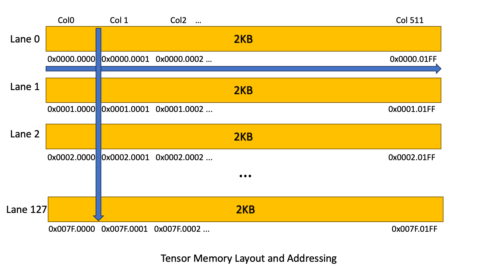

<!-- Generated from https://docs.nvidia.com/cuda/archive/12.9.1/parallel-thread-execution/index.html by tools/build_ptx.py; do not edit. -->

# 9.7.16.1. Tensor Memory

The 5^(th) generation TensorCore has dedicated on-chip memory that is specialized for use by TensorCore operations. This Tensor Memory is organized as a two-dimensional matrix where the horizontal rows are called lanes and the vertical columns are called columns.

On architecture `sm_100a`/`sm_100f`, the 5^(th) generation TensorCore’s Tensor Memory has a two-dimensional structure of 512 columns and 128 rows per CTA, with each cell being 32-bits in size.

Restrictions on threads accessing the Tensor Memory via the load and store operations are specified in [Access restrictions](../../instructions/16-tensorcore-5th-generation-family-instructions/08-tensor-memory-and-register-load-store-instructions.md#tcgen05-tensor-memory-ld-st-access-restrictions).

## 9.7.16.1.1. Tensor Memory Addressing

Tensor Memory addresses are 32-bit wide and specify two components.

1.  Lane index

2.  Column index

The layout is as follows:

> |            |              |
> |------------|--------------|
> | 31 16      | 15 0         |
> | Lane index | Column index |

[Figure 182](https://docs.nvidia.com/cuda/archive/12.9.1/parallel-thread-execution/index.html#tensor-memory-layout) shows the view of the Tensor Memory Layout within CTA.

Figure 182 Tensor Memory Layout and Addressing[](#tensor-memory-layout "Permalink to this image")

## 9.7.16.1.2. Tensor Memory Allocation

The Tensor Memory is dynamically allocated. The Tensor Memory must be allocated by a single warp in a CTA using the [Tensor Memory Allocation and Management Instructions](../../instructions/16-tensorcore-5th-generation-family-instructions/07-tensor-memory-allocation-and-management-instructions.md#tcgen05-memory-alloc-manage-instructions).

The allocation and deallocation of [Tensor Memory](#tensor-memory) is performed in terms of columns. The unit of allocation is 32 columns and the number of columns being allocated must be a power of 2. When a column is allocated, all 128 lanes of the column are allocated.

